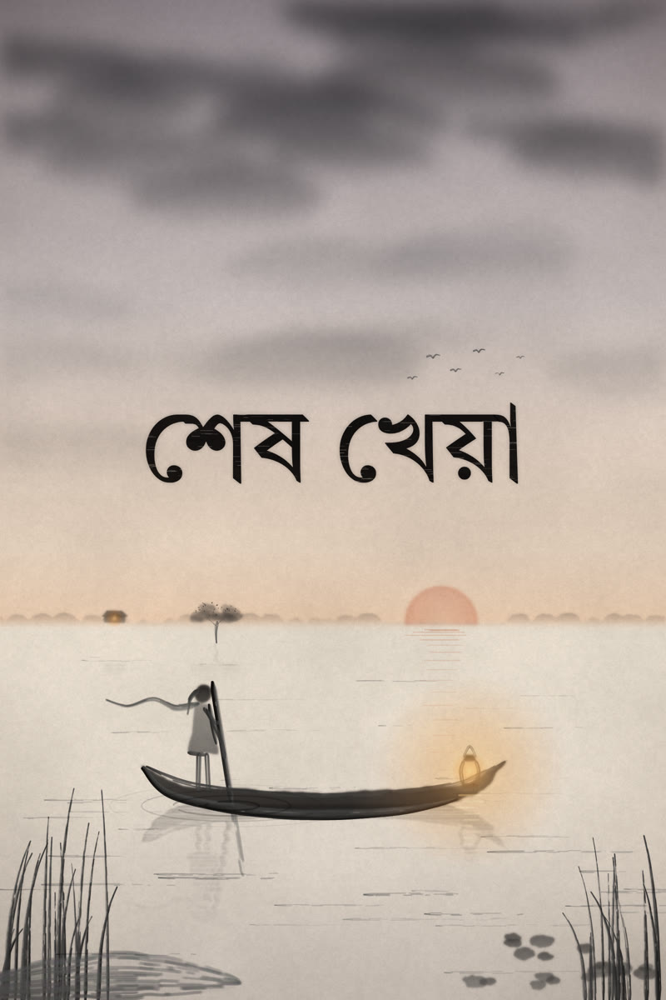
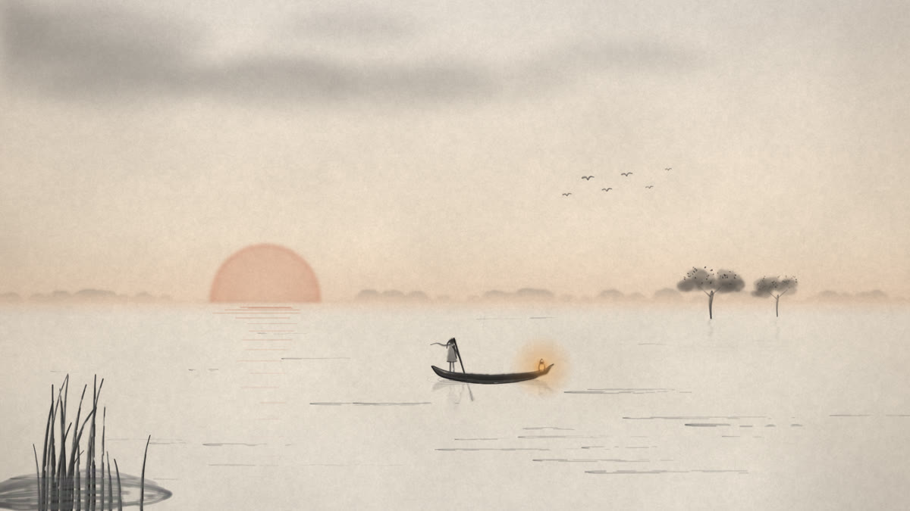
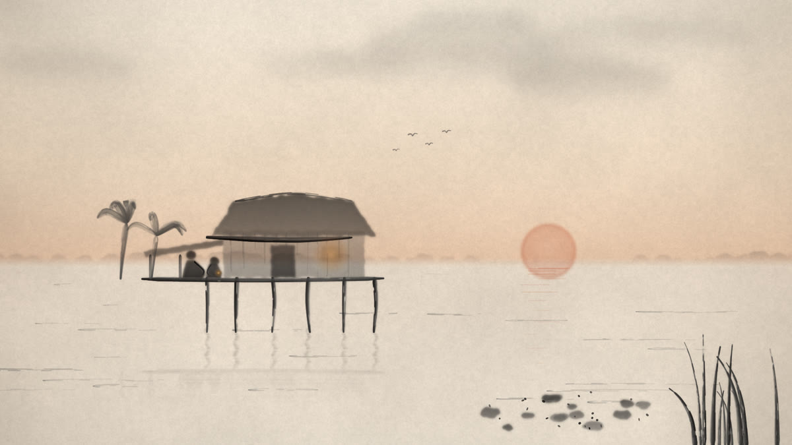
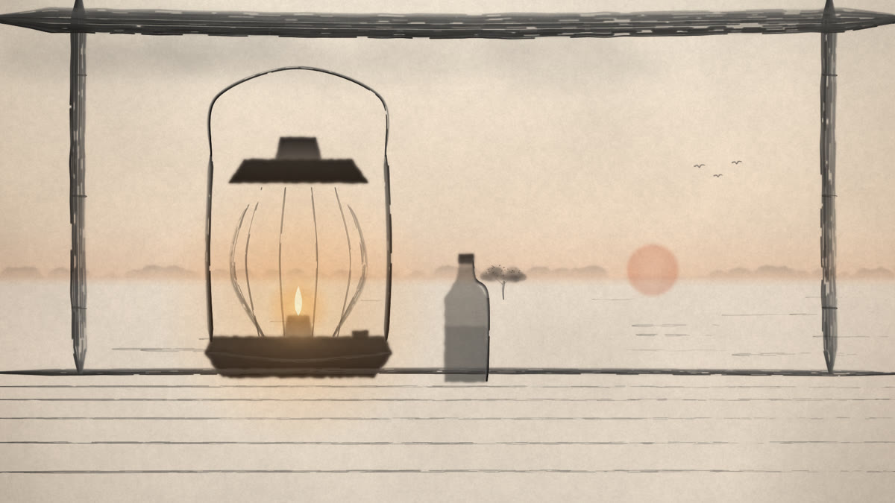
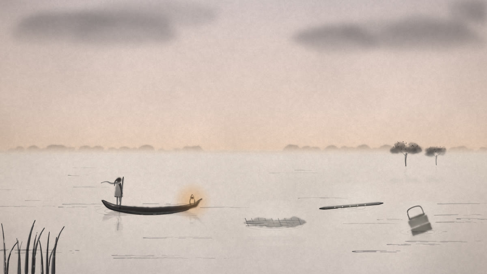
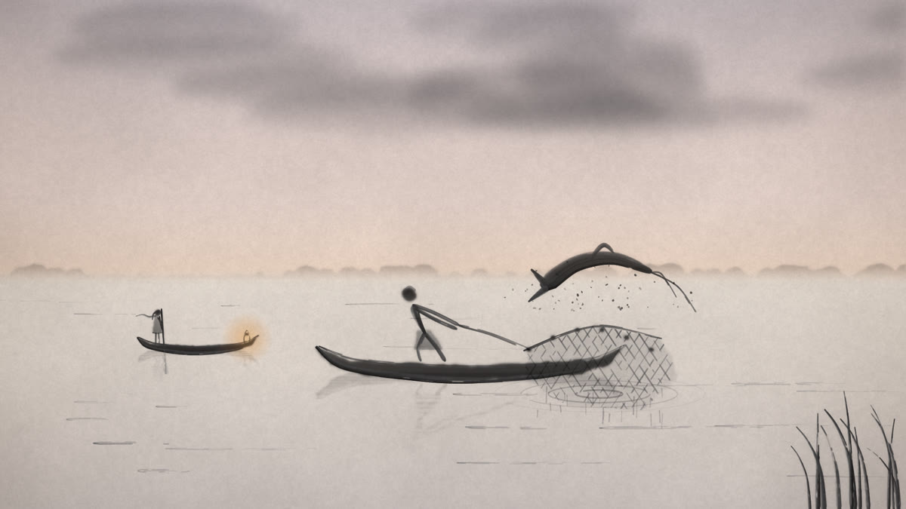
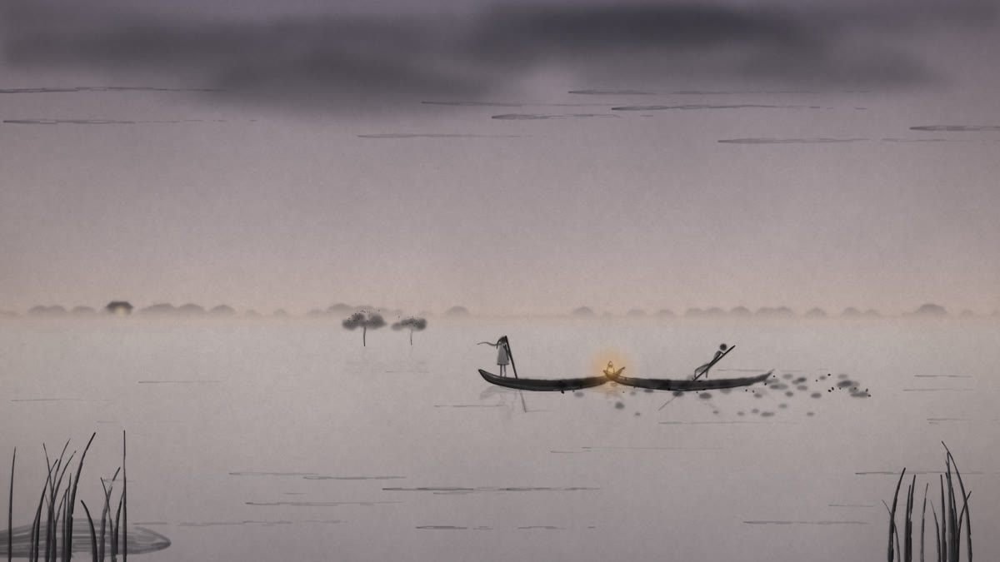
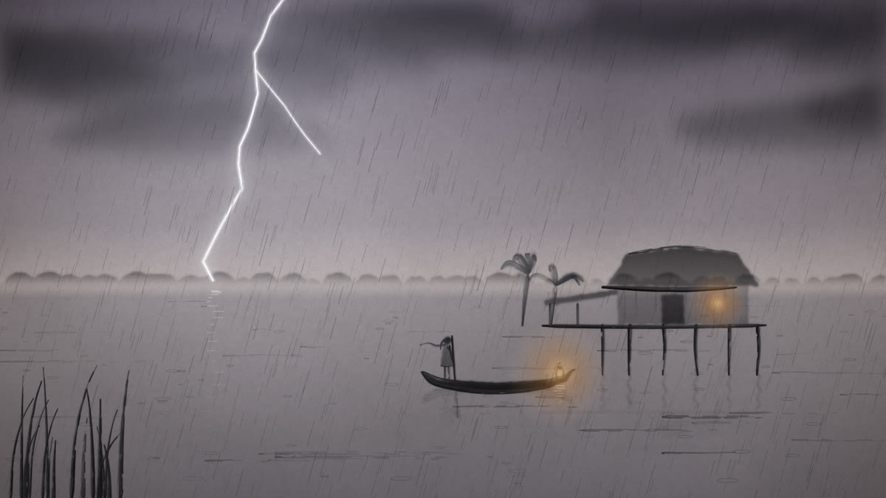
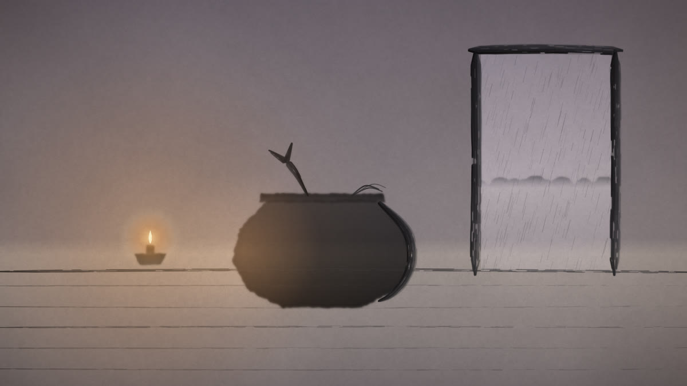

# Shesh Kheya

  

<b>শেষ খেয়া · The Last Ferry</b> 
<i>A short narrative browser game, painted in ink wash.</i>

---

## About

**Shesh Kheya** is a short story game set on a *haor* (a seasonal wetland) in Sylhet, Bangladesh, during the monsoon. You play **Mitu**, a girl whose father has not come home. In one evening that keeps getting darker, she helps her pregnant mother, makes paan for her grandmother, fills the lantern, rows out across the water, helps a fisherman with his net, and decides whether to stop for an old boatman stuck in the water hyacinth. Then the storm arrives.

Chapter 1 (*সন্ধ্যা*, Dusk) lasts about 5–7 minutes. Every activity is small and gentle, and nothing can be failed. Its job is to make you care about this family before the later chapters test that bond. The dialogue is in **Sylheti**, with English subtitles.

This is a **vibe-coded** game, built with AI (Claude Code). It was made as an assignment for my **Algorithms and Complexity** course.

  

## Scenes

<table>
  <tr>
    <td width="50%"> <b>Home:</b> Amma and Dadi wait on the veranda.</td>
    <td width="50%"> <b>The lantern:</b> its oil decides how much light Mitu has later.</td>
  </tr>
  <tr>
    <td> <b>Memories:</b> three of Abba's things, floating on the water.</td>
    <td> <b>Rahim Chacha:</b> pulling the net together.</td>
  </tr>
  <tr>
    <td> <b>Kalam Majhi:</b> the first choice: help, or go home.</td>
    <td> <b>The storm:</b> the light is almost gone.</td>
  </tr>
  <tr>
    <td colspan="2" align="center"> <b>The pot:</b> waiting for Abba.</td>
  </tr>
</table>

## How it's made

- **Ink wash, painted by code.** Every image is painted in the browser on warm paper texture. No illustration software was used. The style takes its technique from Chinese ink wash and its subjects from Bengal: Bengal School wash and Zainul Abedin.
- **Mostly cutscenes, with live play wherever Mitu acts.** Scenes the player only watches are pre-rendered videos. Activities and choices are drawn live. Both use the same drawing function and join on matching frames, so you can't see where the video stops and play begins.
- **No game engine.** Vite, TypeScript, Canvas 2D, HTML `<video>`, an HTML overlay for text, and Web Audio. The renderer that makes the clips runs in headless Chrome (Playwright) and encodes with ffmpeg.
- **All text in one place.** Every line of dialogue lives in `src/content/`, so the Sylheti can be fixed without touching code.

## Status

Planning is done. A working prototype of Scene 5 proves that clips and live play join without a visible seam. Chapter 1 is being built next. Chapters 2–4 are being written.

**Try the prototype:** open `prototypes/s5-cutscene-test/index.html` in a browser.

## What's in the repo

| Path | What it is |
|---|---|
| `docs/source/chapter-1-script.pdf` | The Chapter 1 script (the final word on story) |
| `docs/01-game-design.md` – `08-fable-prompt.md` | Design, architecture, art, audio, code style, build plan, decisions, build prompt |
| `docs/HANDOFF.md` | Where the project stands and what's next |
| `docs/art/` | Full-size paintings and cover |
| `prototypes/s5-cutscene-test/` | Playable Scene 5 prototype |
| `src/content/ch1/dialogue.json` | All Chapter 1 text, Sylheti + English |
| `story/bible.md` | Characters, flags and echoes across chapters |
| `CONTRIBUTING.md` | How the team works |
| `CLAUDE.md` | Rules for AI agents in this repo |

## Team

- **Sameer**: code, art, video, sound.
- **Tibbian**: story and dialogue.
